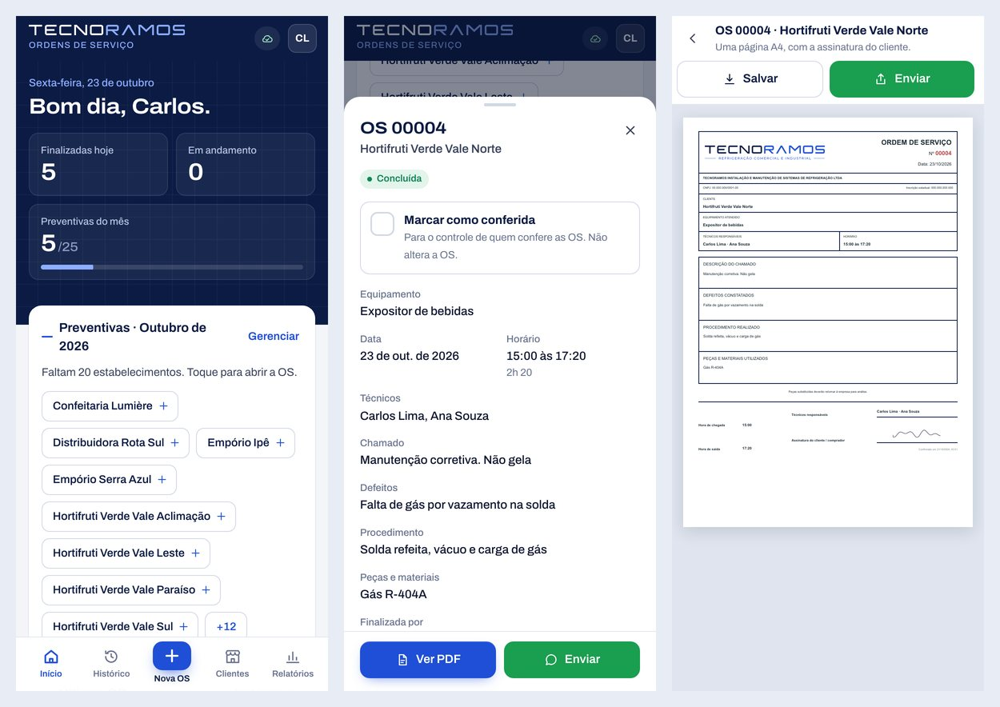

# Tecnoramos OS

[](https://github.com/iDroxz777/tecnoramos-os/actions/workflows/ci.yml)

Sistema de ordens de serviço que eu desenvolvi para a Tecnoramos, uma empresa de refrigeração comercial. Os técnicos abrem a OS pelo celular no local do atendimento, o cliente assina na tela e a OS sai em PDF pronta pra mandar no WhatsApp. Está em uso real pela equipe desde 2026.



> Esta é a versão pública para portfólio, publicada com autorização da empresa. Clientes, CNPJ e usuários foram trocados por dados fictícios; o banco de produção não faz parte deste repositório.

## O que o sistema faz

- **OS pelo celular, mesmo sem internet.** O app funciona como PWA. O técnico preenche a OS offline, ela fica no IndexedDB e sincroniza quando a conexão volta.
- **Assinatura e PDF.** O cliente assina na tela e o sistema gera uma página A4 com a assinatura, compartilhada pelo menu do próprio celular.
- **Preventivas do mês.** A tela inicial mostra quantos estabelecimentos já receberam a preventiva e quais ainda faltam.
- **Perfis de acesso.** O técnico cria OS e consulta o histórico. Cadastro de usuários e clientes, relatórios, correções e lixeira ficam só com o administrador.
- **Histórico pesquisável e relatório por cliente**, com busca por equipamento, defeito ou procedimento.

## Decisões de back-end

- **Sincronização sem duplicar OS.** Cada OS sai do celular com um `client_request_id`. Se a conexão cair no meio do envio e o app tentar de novo, o servidor reconhece o ID e devolve a OS já salva em vez de criar outra (`app/api/orders/route.ts`).
- **Numeração sem buraco nem repetição.** O número da OS vem de um contador no banco, atualizado com `UPDATE ... RETURNING`, então duas OS enviadas ao mesmo tempo nunca recebem o mesmo número.
- **Nada é apagado de verdade.** Excluir uma OS só a move pra lixeira (`deleted_at`, `deleted_by` e o motivo). Corrigir uma OS assinada cria uma nova revisão ligada à original. Toda ação importante entra na tabela de auditoria.
- **Migrações só aditivas.** O sistema já tinha dados reais quando o esquema mudou, então as migrações em `drizzle/` só adicionam colunas e tabelas. Há um teste que falha se alguma migração tiver `DROP TABLE` ou `DELETE FROM orders`.
- **Autenticação própria.** Senhas com PBKDF2 (100 mil iterações e salt por usuário) e comparação em tempo constante. A sessão fica num cookie `HttpOnly`, o login é bloqueado depois de várias tentativas erradas e as rotas que alteram dados recusam requisições de outra origem.
- **API nunca vai pro cache.** O service worker guarda só os arquivos do app; tudo que começa com `/api/` vai sempre para a rede.

## Stack

Next.js 16 (via vinext) · React 19 · TypeScript · Cloudflare Workers · Cloudflare D1 (SQLite) · Drizzle · IndexedDB · Service Worker · jsPDF

## Estrutura

```text
app/api/        rotas do back-end (auth, orders, clients, users, audit, export...)
app/ui/         telas e componentes
app/offline-db.ts   fila offline no IndexedDB
db/schema.ts    esquema do banco
drizzle/        migrações
tests/          39 testes com node:test
```

## Rodando local

Requer Node.js 22.13 ou superior.

```bash
npm install
npm run dev
```

Na primeira vez, o sistema permite criar a conta `admin`. As outras contas são criadas por ela.

```bash
npm run lint
npm test   # faz o build e roda os testes
```

Para publicar na sua própria conta da Cloudflare, crie um banco D1 e coloque o ID dele em `wrangler.cloudflare.jsonc`.

---

**EN:** Service order system I built for a commercial refrigeration company, used daily by its technicians. Offline-first PWA on Cloudflare Workers and D1: orders are filled in on the phone without signal and synced idempotently, the customer signs on screen and the app generates a one-page PDF. Back-end highlights: idempotent sync, race-free order numbering, soft deletes with an audit trail, additive-only migrations and PBKDF2 auth with login lockout. Client data in this public version is fictional.
